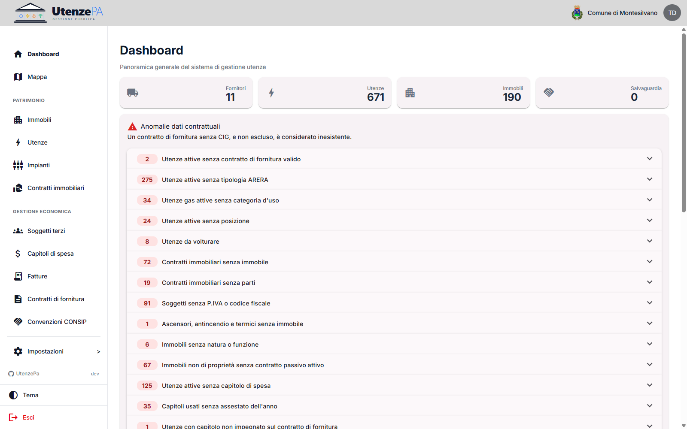
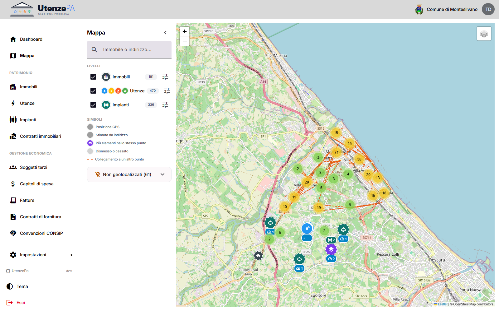
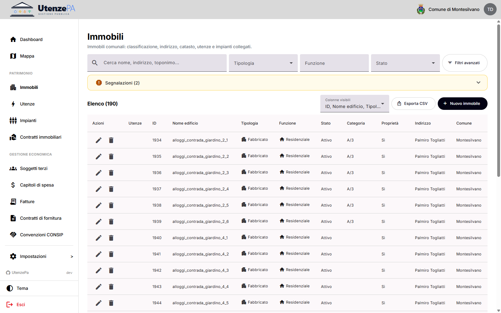
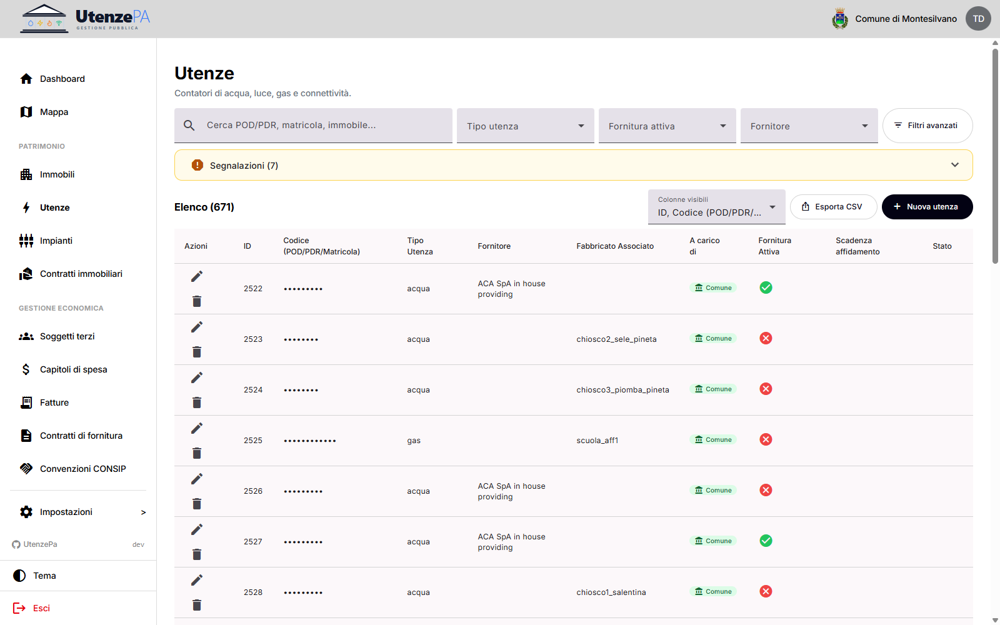

<p align="center">
  <picture>
    <source media="(prefers-color-scheme: dark)" srcset="docs/assets/logo-dark.svg">
    
  </picture>
</p>

Gestionale open-source del patrimonio immobiliare, degli impianti tecnici e delle utenze per enti pubblici locali: complessi, immobili (catasto e censimento MEF), impianti e verifiche di legge, utenze (storico forniture, volture e consumi), soggetti terzi, contratti immobiliari e di fornitura, convenzioni CONSIP, capitoli e impegni di spesa, fatture (con importazione automatica da PEC SDI) e atti amministrativi.

Nato per il Comune di Montesilvano, ma pensato per il riuso: nome ente, tipo, coordinate mappa di default, logo e favicon sono configurabili da interfaccia in **Impostazioni > Branding** (da cui viene derivato anche il Comune per la geocodifica e la ricerca indirizzi), senza alcuna modifica al codice né rebuild delle immagini.

## Screenshot

Tema chiaro o scuro secondo il sistema, oppure scelto dalla voce **Tema** della barra laterale. Le immagini seguono il tema di GitHub.

| Login | Dashboard |
|---|---|
| <picture><source media="(prefers-color-scheme: dark)" srcset="docs/screenshots/01-login-dark.png"></picture> | <picture><source media="(prefers-color-scheme: dark)" srcset="docs/screenshots/02-dashboard-dark.png"></picture> |

| Mappa | Immobili |
|---|---|
| <picture><source media="(prefers-color-scheme: dark)" srcset="docs/screenshots/03-mappa-dark.png"></picture> | <picture><source media="(prefers-color-scheme: dark)" srcset="docs/screenshots/04-immobili-dark.png"></picture> |

| Utenze |
|---|
| <picture><source media="(prefers-color-scheme: dark)" srcset="docs/screenshots/05-utenze-dark.png"></picture> |

## Architettura

Monorepo semplice (nessun workspace tool): `backend/` (NestJS) + `frontend/` (Angular), orchestrati da Docker Compose in root.

| Servizio | Tecnologia | Porta default |
|---|---|---|
| **Backend API** | NestJS 11 (Node ≥24) | 3000 (debug 9229) |
| **Frontend** | Angular 22 + Angular Material | 4300 |
| **Database** | MySQL 8 | 3307 |

## Prerequisiti

- [Docker](https://docs.docker.com/get-docker/) e [Docker Compose](https://docs.docker.com/compose/install/)
- (Opzionale, solo per sviluppo senza Docker) Node.js ≥24 — la versione richiesta da `backend/package.json` può non corrispondere a quella installata sull'host

## Avvio rapido

```bash
git clone https://github.com/Comune-di-Montesilvano/UtenzePA.git
cd UtenzePA

cp .env.example .env
# In sviluppo, scommenta COMPOSE_FILE in .env per attivare l'override
# (build locale + bind mount, invece delle immagini da GHCR)

docker compose up -d
```

Una volta avviati i container:

- **Frontend**: [http://localhost:4300](http://localhost:4300)
- **Backend API**: [http://localhost:3000](http://localhost:3000)
- **Swagger API docs**: [http://localhost:3000/api-docs](http://localhost:3000/api-docs) (solo se `SWAGGER=true`, mai in produzione pubblica)

Al primo avvio, con database vuoto, l'app reindirizza automaticamente al wizard di creazione del primo utente amministratore (`/setup`) — vedi sezione "Bootstrap del primo Admin" più sotto.

## Variabili d'ambiente

Configurazione tramite un file `.env` nella root, copiato da `.env.example` (elenco completo e commentato, fare sempre riferimento a quel file per l'ultima versione aggiornata). Le principali:

### Porte esterne

| Variabile | Default | Descrizione |
|---|---|---|
| `DOCKER_API_PORT` | `3000` | Porta esposta dal backend |
| `DOCKER_FRONTEND_PORT` | `4300` | Porta esposta dal frontend |

### Database MySQL

| Variabile | Default | Descrizione |
|---|---|---|
| `MYSQL_PASSWORD` | _(obbligatoria)_ | Password root MySQL — genera con `openssl rand -hex 24` |
| `MYSQL_DB` | `mydatabase` | Nome del database |

### Secret applicativi (obbligatori in produzione)

| Variabile | Default | Descrizione |
|---|---|---|
| `JWT_ACCESS_SECRET` | _(obbligatoria)_ | Firma i token JWT — genera con `openssl rand -hex 32` |
| `JWT_EXPIRES_IN` | `1h` | Durata del token di accesso (rinnovato automaticamente ogni 15 min durante la sessione attiva) |
| `COOKIE_SECRET` | _(obbligatoria)_ | Firma i cookie — genera con `openssl rand -hex 32` |
| `SETUP_BOOTSTRAP_TOKEN` | _(obbligatoria)_ | Protegge il wizard di creazione del primo Admin — comunicato fuori banda a chi lo esegue |

### Rete / CORS

| Variabile | Descrizione |
|---|---|
| `CORS_ORIGIN` | Origine (o lista separata da virgola) ammessa dal backend — deve combaciare con l'URL reale del frontend visto dal browser |
| `API_URL` | URL del backend raggiungibile dal browser, iniettato a runtime nel frontend |

### Login LDAP / Active Directory (opzionale, ruolo Lettore)

| Variabile | Default | Descrizione |
|---|---|---|
| `LDAP_HOST` | _(vuota)_ | URL server LDAP/AD (es. `ldap://...` o `ldaps://...`). Vuoto = login LDAP disabilitato |
| `LDAP_USER_DN_TEMPLATE` | `%s@comune.montesilvano.pe.it` | Template DN utente (`%s` sostituito con lo username AD inserito al login) |
| `LDAP_BASE_DN` | `DC=comune,DC=montesilvano,DC=pe,DC=it` | Base DN per la ricerca dell'utente |
| `LDAP_REQUIRED_GROUP` | _(vuota)_ | `CN` del gruppo AD richiesto per l'accesso in sola lettura (con auto-provisioning al primo login) |
| `LDAP_TLS_SKIP_VERIFY` | `false` | Solo per test con certificato self-signed, mai `true` in produzione |

### Import fatture dalla PEC SDI (opzionale, IMAP in sola lettura)

| Variabile | Default | Descrizione |
|---|---|---|
| `PEC_IMAP_HOST` | _(vuota)_ | Host IMAP della casella PEC che riceve le fatture dallo SDI |
| `PEC_IMAP_PORT` | `993` | Porta IMAP |
| `PEC_IMAP_TLS` | `true` | Connessione TLS |
| `PEC_IMAP_USER` / `PEC_IMAP_PASSWORD` | _(vuote)_ | Credenziali della casella PEC |
| `INVOICE_IMPORT_CRON` | `*/15 * * * *` | Frequenza di lettura della casella PEC |
| `INVOICE_IMPORT_DISABLED` | `false` (prod) / `true` (dev) | Spegne forzatamente il motore di importazione, interruttore UI incluso |

### Backup, Allegati e Osservabilità

| Variabile | Default | Descrizione |
|---|---|---|
| `BACKUP_CRON_SCHEDULE` | `0 0 * * *` | Pianificazione cron dei backup automatici |
| `BACKUP_KEEP_DAILY` / `WEEKLY` / `MONTHLY` / `YEARLY` | `7` / `4` / `12` / `0` | Retention a scaglioni: conserva il backup più recente di ciascuno degli ultimi N giorni, settimane ISO, mesi e anni con backup |
| `BACKUP_MAX_SIZE_MB` | `20480` | Dimensione massima del file di backup caricabile per il ripristino (in MB) |
| `ATTACHMENT_MAX_SIZE_MB` | `50` | Dimensione massima per singolo allegato di immobili, impianti, contratti e atti (in MB) |
| `SWAGGER` | `false` | Espone `/api-docs` — mai `true` in produzione pubblica |
| `LOG_LEVEL` | `info` | `error`/`warn`/`info`/`debug`/`verbose` — cambiabile senza rebuild, solo restart |
| `SENTRY_DSN` / `SENTRY_ENVIRONMENT` | _(vuote)_ | DSN e tag ambiente Sentry/GlitchTip per error tracking — assente = tracking disabilitato |

## Moduli API

Il backend espone risorse REST sotto `/api/v1`, un modulo NestJS per dominio (`backend/src/apis/`):

| Modulo | Descrizione |
|---|---|
| `auth`, `setup` | Login (locale email+password e LDAP/AD), rinnovo token, logout, reset password via OTP, bootstrap del primo Admin |
| `system-users` | Utenti di sistema, ruoli (`Admin`, `Operatore`, `Lettore`) e utente di sistema `UtenzePA (automatico)` |
| `settings` | Branding ente (nome/tipo, coordinate mappa, logo, favicon) e Comune di riferimento |
| `complexes` | Complessi immobiliari (fisici e amministrativi, 13 tipologie di compendio MEF 2025) |
| `asset`, `asset-natures`, `asset-functions` | Immobili, unità catastali multiple, dati patrimoniali/MEF e classificazione Tipologia × Funzione |
| `plants` | Impianti tecnici (termici, elettrici DM 37/08 – DPR 462/01, fotovoltaici, ascensori, presidi antincendio, vie di esodo, sollevamento/acque meteoriche, ecocompattatori) e verifiche periodiche di legge |
| `utility`, `utility-types`, `utility-supply`, `utility-consumptions` | Utenze (luce, gas, acqua, connettività), tipologie ARERA e categorie uso gas, storico attivazioni/cessazioni/volture (`SupplyReconcileService`), rilevazioni e stime consumi (anche per fasce `F1`–`F3` e penali reattiva) |
| `third-parties` | Soggetti terzi: anagrafica unificata di fornitori, locatori, conduttori e concessionari con ruoli derivati |
| `utilizer-grant` | Contratti immobiliari (concessioni, locazioni attive/passive, comodati), parti contraenti N-N, regime IVA e decisioni di voltura utenze |
| `contracts`, `consip-agreement` | Contratti di fornitura (ordinari con CIG, esclusi da CIG, gratuiti), rinnovi/accorpamenti e convenzioni CONSIP |
| `budget-chapters`, `budget-chapter-spending`, `budget-commitments`, `spending` | Capitoli di spesa, stanziamenti e assestato per esercizio, impegni di spesa N-N con i contratti (riconciliazione automatica delle righe fattura) e calcolo della spesa per competenza |
| `invoices`, `invoice-import` | Fatture e note di credito con righe per utenza/contratto, stato SDI, lettura automatica da PEC SDI ed editor dei pattern di estrazione (XML e testo/tabelle del PDF allegato) |
| `acts`, `act-types`, `attachments`, `photos` | Atti amministrativi (determine, delibere, verbali, ecc.), allegati (upload a chunk con verifica firme binarie, inclusi `.p7m` e `.dwg`) e foto |
| `map`, `geocoding` | Mappa interattiva a livelli (Complessi, Immobili, Utenze, Impianti), ricerca indirizzo e geocodifica automatica |
| `anomalies` | Controlli e segnalazioni di coerenza per la dashboard e per i singoli elenchi |
| `audit-log` | Registro attività: tracciamento modifiche campo-per-campo (`CREATE`, `UPDATE`, `DELETE`) e accessi (`LOGIN`, `LOGOUT`, `TIMEOUT`) |
| `backup`, `health` | Backup/ripristino con foto e allegati multi-GB, retention a scaglioni, modalità manutenzione e health check |

## Bootstrap del primo Admin

Non esiste un modo per creare un utente amministratore da riga di comando: la creazione utenti (`POST /system-users`) richiede già un Admin autenticato. Il primo Admin si crea tramite il wizard `/setup` (disponibile solo finché il database non ha alcun utente umano, si disattiva automaticamente dopo):

1. Apri `http://localhost:4300/setup` (o vieni reindirizzato lì automaticamente da `/login` finché non esiste alcun utente).
2. Inserisci nome, cognome, email, password e il `SETUP_BOOTSTRAP_TOKEN` configurato in `.env`.
3. Ricevi un codice OTP via email (in sviluppo: [mailpit](http://localhost:8026), porta da `docker-compose.override.yml` — verifica in `.env` se sovrascritta per conflitti con altri progetti locali).
4. Inserisci il codice per completare la creazione dell'Admin.

## Branding

Da `Impostazioni > Branding` (solo ruolo Admin) si configurano, senza toccare codice o rebuild:

- Nome e tipo ente (es. "Comune di Montesilvano" / "Comune") — dal nome ente viene ricavato anche il Comune usato per geocodificare gli impianti e dare priorità alla ricerca indirizzi in mappa
- Coordinate di default della mappa geolocalizzazione (scelte cliccando su una mini-mappa)
- Logo (mostrato in header e login)
- Favicon (tab del browser)

Il valore di default al primo avvio (seed di migration) è quello del Comune di Montesilvano — cambialo da qui per un altro ente.

## Frontend

Interfaccia in **Angular 22** con **Angular Material**, schede entità navigabili a pila con creazione al volo (`+`), elenchi uniformi con filtri avanzati a sezioni e pannello **Segnalazioni**, selettore **Tema** (Chiaro / Scuro / Sistema) e **Guida operatori** integrata (`/guida`, apribile anche contestualmente con `?`).

Sezioni principali del menu laterale:

- **Dashboard** e **Mappa** a livelli (*Complessi*, *Immobili*, *Utenze*, *Impianti*, ricerca indirizzo e apertura Google Street View)
- **Patrimonio** — **Complessi**, **Immobili**, **Impianti**, **Contratti immobiliari**, **Utenze**
- **Gestione economica** — **Soggetti terzi**, **Contratti di fornitura**, **Convenzioni CONSIP**, **Capitoli di spesa**, **Impegni di spesa**, **Fatture**, **Atti**
- **Impostazioni** — Tipi di utenza, Tipologie e Funzioni immobile, Tipi di atto, Import fatture (Motore PEC e Pattern), Backup e manutenzione, Branding, Utenti e ruoli, Log attività
- **Guida** (`/guida`)

## Sviluppo

Il backend richiede Node ≥24: se l'host locale ha una versione diversa, i comandi vanno lanciati dentro il container (`docker exec utenzepa-api-1 ...` / `utenzepa-frontend-1`), non sull'host — vedi `CLAUDE.md` per i dettagli ed esempi.

### Backend

```bash
cd backend
pnpm install
pnpm run start:dev        # watch mode, porta 3000
```

### Frontend

```bash
cd frontend
pnpm install
pnpm run start             # ng serve, porta 4300
pnpm run build             # verifica guida Markdown (check-guida.mjs) + ng build production
```

### Test e controlli (backend)

```bash
cd backend
pnpm run test:unit -- --maxWorkers=2          # tutti gli unit test (src/**/*.spec.ts)
pnpm run lint                                 # ESLint
pnpm run type-check                           # tsc --noEmit
pnpm run build                                # nest build
```

`--maxWorkers=2` sempre: l'ambiente di sviluppo tipico ha poche CPU disponibili, jest di default ne satura quante ne trova.

### Load testing

Il backend include configurazioni [Artillery](https://www.artillery.io/) (`backend/artillery/`):

```bash
cd backend
pnpm run artillery:low      # carico basso
pnpm run artillery:medium   # carico medio
pnpm run artillery:high     # carico alto
pnpm run artillery:massive  # carico massivo
pnpm run artillery:all      # tutti in sequenza
```

## Sicurezza

- Autenticazione **JWT con scadenza** (`JWT_EXPIRES_IN`, default `1h`) e rinnovo automatico ogni 15 minuti durante la sessione attiva (`POST /authModule/refresh`, che verifica stato e ruolo sul DB); disconnessione automatica dopo 30 minuti di inattività
- Login **LDAP / Active Directory** opzionale per gli utenti con ruolo `Lettore` (con filtro per gruppo AD e auto-provisioning al primo accesso)
- **OTP via email** per il bootstrap del primo Admin (`/setup`, protetto anche da `SETUP_BOOTSTRAP_TOKEN`) e per il reset password — mai esposto nelle risposte API
- Hashing password con **bcrypt** (cost factor 10)
- Tutela dati personali per il ruolo `Lettore`: oscuramento automatico di codice fiscale e contatti dei soggetti terzi persone fisiche; elenco utenti e log globale riservati agli `Admin`
- Validazione delle firme binarie e della struttura reale dei file caricati come allegati (`attachment-file-policy.ts`, mai basata sul solo MIME dichiarato dal browser)
- Tracciamento degli accessi (`LOGIN`, `LOGOUT`, `TIMEOUT`) e delle modifiche in `audit_logs`
- Header di sicurezza HTTP via [helmet](https://helmetjs.github.io/) e CORS ristretto a whitelist esplicita (`CORS_ORIGIN`)
- Gestione secret con [Infisical](https://infisical.com/) (opzionale) ed error tracking con [Sentry](https://sentry.io/) / [GlitchTip](https://glitchtip.com/) (opzionale, via `SENTRY_DSN`)

## Struttura del progetto

```
UtenzePA/
├── .github/                     # Workflow CI/CD (test, release GHCR, publiccode)
├── docker-compose.yml           # Orchestrazione servizi (produzione)
├── docker-compose.override.yml  # Override sviluppo (build locale, bind mount, mailpit)
├── .env.example                 # Variabili d'ambiente documentate
├── publiccode.yml               # Metadata per il catalogo riuso PA
├── docs/                        # Screenshot, asset, roadmap e note tecniche (docs/claude/)
├── backend/                     # API NestJS
│   ├── src/
│   │   ├── apis/                # Moduli di dominio (controller/service/entity per risorsa)
│   │   ├── common/, helpers/, utils/
│   │   ├── core/                 # Auth, database, cronjobs, email, exceptions
│   │   └── database/migrations/  # Migration TypeORM + data-source per la CLI
│   ├── artillery/                # Configurazioni load test
│   └── postman/                  # Collection Postman
└── frontend/                     # App Angular
    ├── public/guida/guida.md     # Guida operativa in Markdown
    ├── scripts/check-guida.mjs   # Validazione ancore e struttura della guida
    └── src/
        ├── app/
        │   ├── pages/             # Pagine, schede entità e impostazioni
        │   ├── services/          # Servizi comunicazione API
        │   └── guards/, layout/, core/
        └── environments/
```

## Contribuire

Prima di aprire una PR:
- lancia `pnpm run lint`/`pnpm run test:unit -- --maxWorkers=2` (backend) e `pnpm run build` (frontend, se tocchi codice Angular) — dentro il container se l'host non ha Node ≥24
- affidati a CI (`.github/workflows/tests.yml`, gira su ogni push/PR verso `main`) come gate autoritativo prima del merge
- leggi `CLAUDE.md` per le convenzioni del repo e le note operative accumulate

## Licenza

Distribuito sotto licenza [EUPL-1.2](LICENSE).
